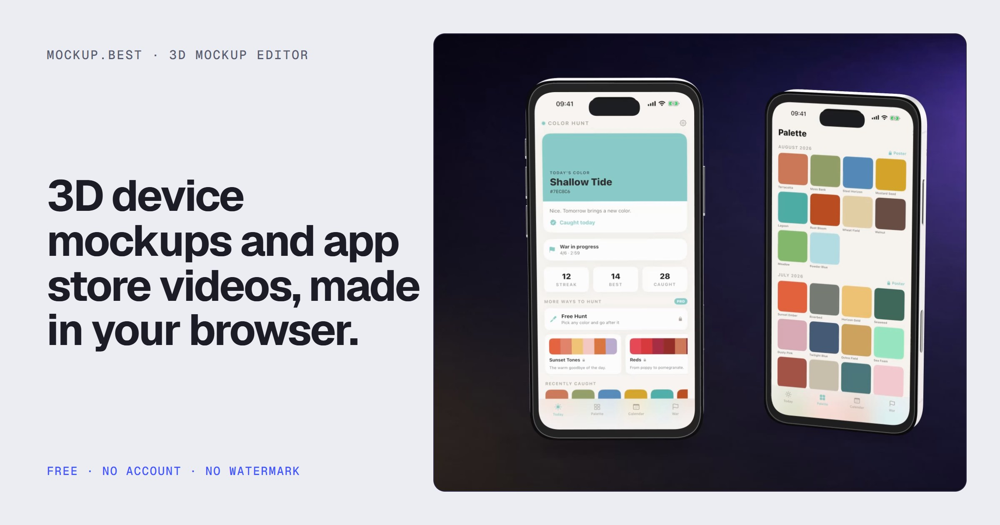

# mockup.best

**Free 3D device mockups and app promo videos, made in your browser.**

Drop in a screenshot or a screen recording, put it on a 3D phone, laptop, tablet or
watch, move the camera on a timeline and export a 5K still, a 4K/60 video or a ready
App Store / Google Play screenshot set. No account, no watermark, no upload: your
files never leave your browser.

**Try it:** [mockup.best](https://mockup.best)



## What's inside

Most of this repo is a regular editor UI. Underneath it are a few pieces we think are
useful on their own:

- **Karekare: frame-by-frame video export** (`src/components/scene/karekare.ts`,
  `exportBridge.ts`). *Karekare* is Turkish for "frame by frame". Browser tools usually
  record the canvas in real time, so a slow frame becomes a dropped frame in the file.
  Karekare drives the clock itself: it sets the playhead to `i / fps`, renders, and
  hands the frame to `VideoEncoder` (WebCodecs) + `mp4-muxer`. A slow machine takes
  longer, but the output is identical everywhere: same frame count, same duration,
  same pixels. 4K/60 MP4 and transparent WebM come out of the same path.
- **Image quality pipeline** (`src/components/scene/`):
  - `jitterPass.ts`: kills edge shimmer on thin specular lines by rendering the scene
    8–16 times with sub-pixel offsets (D3D MSAA patterns) and averaging.
  - `dofPass.ts`: two-pass bokeh depth of field (gather at half resolution with
    per-sample circles of confusion, then a sharp-preserving composite), so the
    device edge never bleeds into the blurred background.
  - `hdrStudio.ts`: a small "light studio" with real HDR panels (values far above
    1.0) baked into a PMREM environment, which is what gives metal frames their thin,
    bright highlight lines.
- **Device factory** (`tools/devices3d/`). The 12 device models in `public/models/`
  were not downloaded from anywhere. They are generated by Blender scripts from real
  millimetre dimensions, then compressed with meshopt. Adding a device is a script edit.
- **Beat detection** (`src/lib/beats.ts`). Tempo and beat times from an audio file,
  fully client-side: spectral-flux onsets, autocorrelation tempo, dynamic-programming
  beat tracking (Ellis 2007). Scene cuts and keyframes can snap to beats. ~300 lines,
  no dependencies.
- **Magic Reel** (`src/config/reel.ts`). Turns 1–4 screenshots into a promo video using
  a small set of measured camera rules and edit grammar.
- **Small tools:** sensitive-info redaction baked into the screenshot
  (`src/config/redact.ts`), an App Store / Google Play screenshot size and alpha-channel
  checker (`src/components/landing/SizeChecker.tsx`), and on-screen tap ripples, rings,
  spotlights and cursor (`src/components/scene/screenMarks.ts`).

## Running it

Requires Node.js 20+.

```bash
npm ci
npm run dev        # http://localhost:5757
npm run build      # static export into out/
npm run lint
```

The app is a fully static site (`output: "export"`): there is no backend. Projects,
settings and history live in `localStorage`.

Analytics is off by default. It only loads when `NEXT_PUBLIC_ANALYTICS`,
`NEXT_PUBLIC_ANALYTICS_SRC` and `NEXT_PUBLIC_ANALYTICS_ID` are set (Umami or Plausible,
see `src/config/analytics.ts`).

### End-to-end tests

The tests drive a real, GPU-backed headless Chrome through Puppeteer against a running
dev server:

```bash
npm run dev              # in one terminal
npm run test:e2e         # in another (TEST_URL=http://localhost:5757 by default)
```

They cover the Karekare export (correct duration even with a blocked main thread),
PNG export, transparent video and beat detection.

### Rebuilding assets

- Device models: `node tools/devices3d/build-all.mjs [device ...]` (needs Blender 5.x;
  set `BLENDER` to its executable).
- Demo screens: `node tools/gen-showcase-screens.mjs`. The UI of the fictional demo
  apps is HTML in `tools/demo-screens/`; only the photos in `tools/demo-photos/` are
  generated images. The demo backdrop is drawn by `python tools/stage_bg.py public/demo/stage.jpg`
  (needs `numpy` and `Pillow`).

## Project layout

```
src/
  app/                 Next.js routes (editor, landing, EN + TR pages)
  components/scene/    three.js scene, render passes, Karekare export
  components/shell/    editor shell: top bar, timeline, panels, export menu
  components/landing/  landing and use-case pages
  modules/photo/       2D "Photo" mode (perspective warp onto photos)
  store/               Zustand state, undo/redo, project files
  config/              devices, backgrounds, templates, motion presets
  lib/                 beats, gif, zip, csv helpers
tests/                 Puppeteer end-to-end tests
tools/                 device generator, demo screen generator
public/                models, HDR environments, demo and landing media
```

## License

The code is licensed under the **GNU Affero General Public License v3.0**
(`AGPL-3.0-only`), see [LICENSE](LICENSE). Copyright © 2026 Hugo Software Ltd.

In short: you can use, study, change and share it. If you run a modified version as a
network service, you must offer its source code to its users under the same license.

**Not covered by the license:**

- The names **mockup.best** and **BNJ** and their logos are trademarks of
  Hugo Software Ltd. A fork must use its own name and logo.
- Screenshots of the **Color Hunt** app (`public/demo/colorhunt-*.jpg`) and the
  landing media that show them (`public/og.jpg`, `public/lp/hero*`,
  `public/uses/app-store-*`, `public/uses/promo*`) are © Hugo Software Ltd and are
  included for demonstration only.
- The HDR environments in `public/env/` are from [Poly Haven](https://polyhaven.com)
  under CC0: `studio_small_09` (`studio-soft.hdr`) and `photo_studio_loft_hall`
  (`loft.hdr`).

The demo photos in `tools/demo-photos/` were generated locally with FLUX.3 Image Klein.

## Contributing

Issues, bug reports and ideas are very welcome. We are not accepting pull requests
yet.

---

Made by [BNJ](https://bnj.app) · Hugo Software Ltd · support@hugosoftware.net
